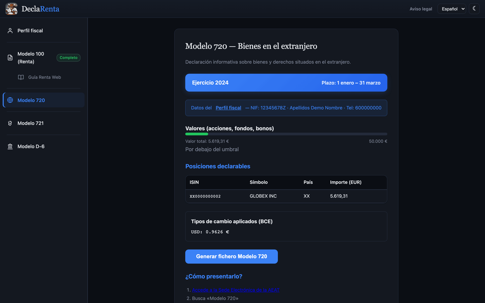

# Modelo 720, 721 y D-6

Las tres declaraciones informativas que DeclaRenta prepara a partir de los mismos ficheros: el fichero del 720, la revisión del 721 y la guía del D-6.

## Modelo 720

### Qué es

El Modelo 720 es una declaración informativa de bienes y derechos situados en el extranjero. No tiene cuota a pagar; es puramente informativo. Lo gestiona la Agencia Tributaria (AEAT).

### Quién debe presentarlo

Cualquier residente fiscal en España que a 31 de diciembre posea bienes en el extranjero cuyo valor **por categoría** supere los **50.000 EUR**. Las tres categorías independientes son:

- **Valores y derechos** (acciones, fondos, bonos) — DeclaRenta la calcula con tus posiciones.
- **Cuentas en entidades financieras** — DeclaRenta la calcula con los saldos en efectivo del broker, cuando el fichero los trae. Suma por separado los saldos a 31 de diciembre y los saldos medios del cuarto trimestre, y la categoría se declara si cualquiera de las dos sumas supera los 50.000 EUR.
- **Bienes inmuebles** — no aplica a posiciones del broker.

Cada categoría se evalúa de forma independiente. Solo se declaran las categorías que superan el umbral.

Si ya lo presentaste, en los años siguientes solo es obligatorio volver a declarar una categoría cuando su valor ha aumentado más de **20.000 EUR** respecto de la última declaración, o cuando has vendido algo que declaraste (arts. 42 bis.5 y 42 ter.5 del RD 1065/2007). Con el fichero de tu último Modelo 720 cargado, la sección te dice para cada categoría si es tu caso.

### Plazo de presentación

Del **1 de enero al 31 de marzo** del ejercicio siguiente.

### Qué genera DeclaRenta

Un fichero de texto de **ancho fijo** (500 bytes por registro) codificado en **ISO-8859-15**, listo para subir a la AEAT. El fichero contiene:

- Un **registro resumen** (tipo 1) con datos del declarante y totales.
- Un **registro detalle** (tipo 2) por cada posición: clave V para acciones (subclave 1) y bonos (subclave 2), clave I para fondos extranjeros; el país donde está depositada (el del bróker) o, en un fondo, el país del fondo; ISIN, valoración a 31/dic, cantidad y porcentaje de titularidad (100 entre el número de titulares del perfil, con el valor completo sin prorratear).
- Un registro de **cuenta** (clave C) por cada saldo en efectivo con media del cuarto trimestre, con el número de cuenta en el campo de código de cuenta.
- Registros de tipo **A** (alta), **M** (modificación) o **C** (cancelación) según si la posición es nueva, ya existía o se ha vendido. Para distinguirlos necesita el fichero .txt de tu último Modelo 720: súbelo en el recuadro «Tu último Modelo 720» de la sección (se lee en el navegador y no se guarda) o pásalo con `--previous-720` en la CLI. Sin ese fichero, todo sale como A. Una cancelación repite la clave y el país con que el fichero del año anterior declaró ese valor. Las versiones anteriores de DeclaRenta dejaban la subclave en blanco: en ese caso la subclave sale de la operación de venta de este año (acciones V1, bonos V2, fondos extranjeros I0). Si no hay venta que la indique, o el fichero anterior usó un país que el BOE no admite, la venta no entra en el fichero y DeclaRenta la lista para que la declares a mano. Lo que el fichero anterior ya dio de baja no se vuelve a cancelar.

Las posiciones sin ISIN, las posiciones sin un número de acciones legible y los bienes o cuentas sin país conocido no caben en el fichero: si su categoría supera los 50.000 €, DeclaRenta los lista para que los declares a mano en el formulario. Una posición sin número de acciones no sale nunca con 0 en «Número de valores»: toma el número del extracto de fin de año del bróker. Una cantidad de 0 junto a un valor distinto de 0 se trata igual, porque ese 0 no es el número de acciones. Una fila con 0 acciones y valor 0 no es una posición: no se escribe. Un 0 solo se da por bueno si al lado hay un valor de 0. Si el valor no es un número («N/A», «NaN», «60,000» o vacío) o falta la columna del valor, ese 0 puede ser un error de la exportación. DeclaRenta trata entonces la posición como una que sigue en cartera, sin número de acciones y sin valorar: no escribe su registro de baja (C) ni la da por vendida frente a tu último 720, y un aviso la nombra. Comprueba en el extracto de fin de año si aún la tienes; si la vendiste, declara la baja a mano. El valor de una posición sin número de acciones sí cuenta para el umbral. Si tampoco trae valor, cuenta como posición sin valorar, y la sección no dice que estés por debajo del umbral. Lo mismo vale para cualquier posición con acciones cuyo valor no es un número (IBKR puede dejarlo vacío o escribir «N/A»): cuenta como sin valorar, nunca como 0 €. Hasta la versión 0.66.14 ese valor hacía fallar la sección del 720 y la del 721. Una posición corta (valor negativo, o un número de acciones negativo si el valor no lo dice) no es un bien que tengas y no entra.

Un número es un decimal finito: `700`, `-12.5` o con exponente (`1e5`). «NaN», «Infinity» o cualquier otro texto no es un número, y la posición cuenta como sin valorar. Hasta la versión 0.66.14 un valor «NaN» convertía el total en NaN, y la sección decía que no superabas el umbral aunque tuvieras más de 50.000 € en otras posiciones.

Si el número de acciones y el valor tienen signos contrarios (700 acciones con valor −5.000, o −700 con valor 5.000), la fila se contradice: no se sabe si es una posición larga o corta. DeclaRenta la trata como una posición que tienes, pero sin valorar, igual en el 720, el 721 y el D-6, y avisa nombrándola. Así nunca la deja fuera como corta cuando podría contar para el umbral. Hasta la versión 0.66.14 el 720 la dejaba fuera como corta y el D-6 la listaba con valor negativo.

Un saldo en efectivo que no se puede valorar en euros no cuenta como 0 €. Pasa cuando el saldo no trae un número legible (IBKR puede dejar vacío el saldo final, escribir «N/A», o no traer la columna) o cuando su moneda no tiene tipo de cambio del BCE a 31 de diciembre (por ejemplo, el yuan offshore CNH de IBKR). La categoría de cuentas lo cuenta como saldo sin valorar, la sección dice «No se puede determinar» si las demás cuentas no superan el umbral, y un aviso nombra la cuenta y la moneda. Ese saldo no entra en el fichero: decláralo a mano con el saldo en euros del extracto de fin de año del bróker. Hasta la versión 0.66.14 un saldo vacío hacía fallar la sección del 720, y un saldo sin tipo de cambio se quedaba fuera sin aviso, así que la sección podía decir que no estabas obligado. La fila BASE_SUMMARY de IBKR es la suma de las demás monedas de la cuenta y no cuenta otra vez; si es la única fila de la cuenta, cuenta como saldo sin valorar. Una media del cuarto trimestre sin un número legible cuenta como media que falta.

El campo «Número de valores» del fichero solo admite dos decimales. Una posición de menos de 0,005 acciones (un resto de acciones fraccionadas) escribiría 0, así que DeclaRenta no la escribe: la lista para que la declares a mano, y su valor sí cuenta para el umbral. Si una fecha de compra aporta menos de 0,005 acciones a una posición mayor, esas acciones se suman al registro de la fecha vecina.

Cada importe del fichero tiene 12 cifras enteras y dos decimales (hasta 999.999.999.999,99 €), y «Número de valores» tiene 10 cifras enteras y dos decimales. El valor de una posición, un saldo o una media del cuarto trimestre que no cabe en su campo cuenta como sin valorar. Un número de acciones que no cabe se lista para que lo declares a mano, y su valor sí cuenta para el umbral. Si el importe de una baja no cabe, su registro C sale con valoración 0 y la sección te pide que lo completes. El fichero nunca escribe un número con exponente (como «8.5e+998»), y cada registro tiene siempre 500 caracteres.

Para acciones (STK), la valoración se calcula con el **tipo medio del cuarto trimestre** del BCE. Para fondos y bonos, se usa el tipo a 31 de diciembre.

### Cómo presentarlo en sede electrónica

1. Accede a **sede.agenciatributaria.gob.es**.
2. Busca "Modelo 720" o navega a *Todas las gestiones > Modelos y formularios > 720*.
3. Selecciona **TGVI Online** (Transmisión de Grandes Volúmenes de Información).
4. Identifícate con certificado digital, DNIe o Cl@ve PIN.
5. Sube el fichero generado por DeclaRenta.
6. Revisa el resumen y confirma el envío.

## Modelo 721

### Qué es

El Modelo 721 es la declaración informativa de monedas virtuales situadas en el extranjero. Es el equivalente del Modelo 720 para criptoactivos.

### Quién debe presentarlo

Cualquier residente fiscal en España que a 31 de diciembre posea criptomonedas en exchanges extranjeros cuyo valor total supere los **50.000 EUR**.

### Exchanges aplicables

Cualquier exchange con sede fuera de España. Los más comunes son Coinbase, Binance y Kraken. Si el exchange tiene sede en España (como Bit2Me), no es necesario declararlo en el 721.

### Qué genera DeclaRenta

La presentación oficial para programas externos se hace en XML según la Orden HFP/886/2023.

!!! warning

    DeclaRenta muestra una revisión orientativa de posiciones cripto, pero la generación oficial del Modelo 721 está desactivada hasta implementar y validar el XML AEAT.

Si el fichero no da un número de unidades legible para una criptomoneda (IBKR puede exportar una posición sin cantidad), la sección muestra sus unidades como «—», nunca 0, y un aviso con esas monedas: toma las unidades del extracto de fin de año del exchange o del bróker. Su valor sí cuenta para el umbral. Si tampoco trae valor, cuenta como posición sin valorar, y la sección dice que no se puede determinar si superas el umbral, en lugar de decir que no estás obligado. Una criptomoneda con unidades cuyo valor no es un número (vacío, «N/A» o «NaN») cuenta igual como sin valorar. Una cantidad de 0 junto a un valor positivo es una cantidad desconocida, nunca 0 unidades; junto a un valor negativo es una posición corta, que no entra. Una cantidad de 0 sin un valor legible al lado (o sin columna de valor) también es desconocida: la criptomoneda sigue en la lista, sin valorar, y un aviso la nombra. Una criptomoneda que la sección lista, con valor o sin él, cuenta como dato del bróker: la sección no dice entonces que los datos de ese bróker no incluyen tus criptomonedas.

## Modelo D-6

### Qué es

El Modelo D-6 es la declaración de inversiones españolas en el exterior. Es independiente del Modelo 720 y se presenta en el Registro de Inversiones Exteriores de la Secretaría de Estado de Comercio, no en el Banco de España.

### Quién debe presentarlo

Desde la Orden ICT/1408/2021, el D-6 suele quedar limitado a participaciones que representen el **10% o más** del capital o derechos de voto de una sociedad cotizada extranjera. La mayoría de carteras minoristas están fuera de este supuesto.

### Plazo de presentación

Del **1 al 31 de enero** del ejercicio siguiente.

### Programa AFORIX

El D-6 se prepara en el **programa AFORIX** de la Secretaría de Estado de Comercio, posición por posición, y se firma electrónicamente en el propio programa. DeclaRenta no genera ese fichero, te da los datos que tienes que escribir en él.

### Qué genera DeclaRenta

Una **guía orientativa de cumplimentación** con los datos que necesitarías introducir en AFORIX si confirmas que existe obligación de presentar:

- ISIN, denominación y país emisor.
- Código de mercado (NYSE, Xetra, LSE, etc.).
- Número de títulos a 31 de diciembre.
- Valor de mercado en EUR al tipo ECB de 31 de diciembre.

Si proporcionas el D-6 del año anterior (vía `--previous-d6`), DeclaRenta genera también las **cancelaciones** para posiciones que ya no mantienes.

Si IBKR lista una posición sin un número de acciones legible (o con 0 acciones y un valor distinto de 0, o con 0 acciones y ningún valor legible que confirme ese 0), la sección D-6 la muestra con «—» en el número de títulos y en el valor, nunca 0, y un aviso que la nombra. En AFORIX cada posición necesita el número de títulos y el valor, así que la sección y la guía D-6 la dejan fuera del valor total y la cuentan entre las que debes declarar a mano. La guía nombra cada una de esas posiciones (ISIN y denominación). Tampoco la da como cancelación, porque el bróker la sigue listando. El Modelo 720 la lista para que la declares a mano, sin escribirla en el fichero con 0 en «Número de valores». Si la posición es corta (valor negativo distinto de 0), no es un bien que tengas, así que el D-6 y el 720 la dan como cancelada. Un valor de «-0» no tiene signo: la posición sigue en cartera en los dos. DeclaRenta avisa de cada una: toma el número de acciones del extracto de fin de año de IBKR.

### Cómo presentarlo

1. Abre el programa AFORIX y crea una declaración del modelo D-6.
2. Introduce cada posición siguiendo la guía generada por DeclaRenta.
3. Revisa la declaración y fírmala electrónicamente en AFORIX.
4. Sube el fichero firmado (`.aforixd`) en [eAFORIX](https://oficinavirtual.comercio.gob.es/eAFORIX/).

## Perfil fiscal

Los tres necesitan el NIF, el nombre y los apellidos del declarante. En la web se rellenan una vez en la sección Perfil fiscal (`#perfil`) y se guardan en el navegador.

La CLI los recibe como `--nif` y `--name` (ver [Uso](usage.md#cli)).
